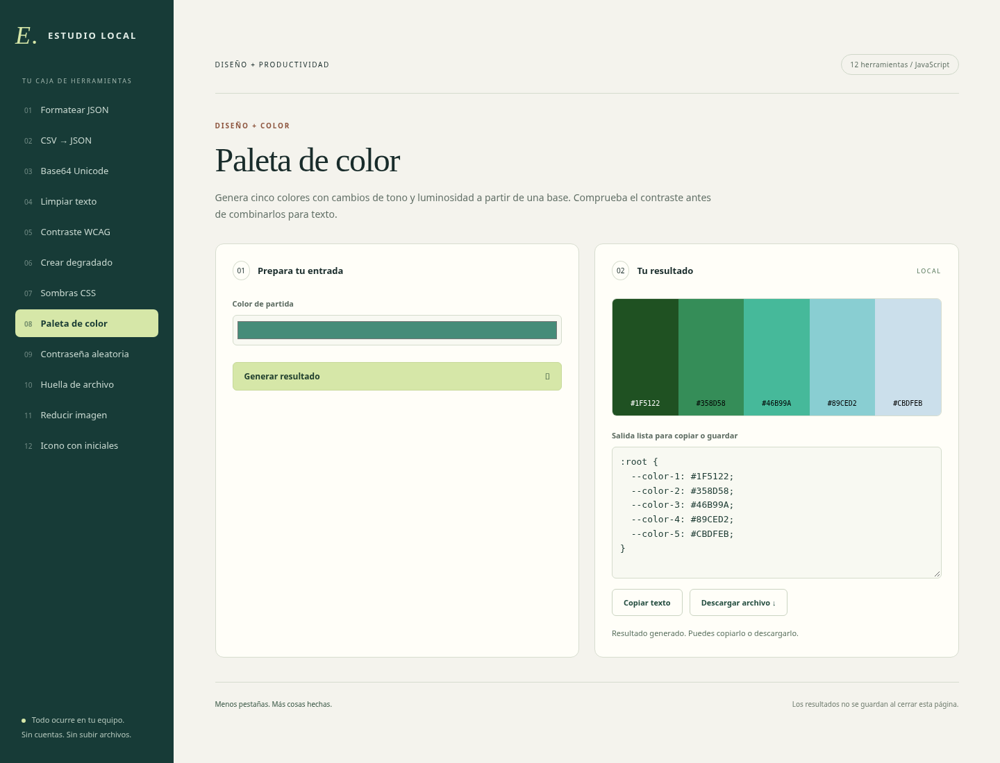

# Scripts-JavaScript · Estudio Local

Doce herramientas visuales para abrir en un navegador moderno, sin instalación,
cuentas, dependencias externas ni envío de archivos. JavaScript es el lenguaje
de las herramientas; HTML y CSS proporcionan su interfaz.

## Empezar

Descarga el repositorio completo y abre `index.html` con Chrome, Edge o Firefox.
Escoge una herramienta, introduce datos y pulsa **Generar resultado**. Puedes
copiar texto o descargar la salida. Si tu navegador limita Web Crypto o el
portapapeles en archivos locales, sirve la carpeta en localhost con tu servidor
habitual; para copiar también puedes seleccionar el texto manualmente.

| Herramienta | Resultado |
| --- | --- |
| Formatear JSON | JSON validado y con sangría |
| CSV a JSON | Convierte cabeceras y celdas, admite comillas y saltos de línea |
| Base64 Unicode | Codificación y decodificación UTF-8 |
| Limpiar texto | Duplicados, espacios, orden y slugs |
| Contraste WCAG | Ratio y umbrales para colores opacos |
| Crear degradado | SVG editable de 1920 × 1080 |
| Sombras CSS | Vista previa y código de sombra |
| Paleta de color | Cinco colores y variables CSS |
| Contraseña aleatoria | Aleatoriedad criptográfica del navegador |
| Huella de archivo | SHA-256 de archivos de hasta 50 MiB |
| Reducir imagen | PNG proporcional sin metadatos, hasta 40 megapíxeles |
| Icono con iniciales | Monograma SVG editable |

No hay almacenamiento persistente: al cerrar o recargar se pierden entradas y
resultados. Las descargas las gestiona el navegador. El texto, los secretos y
los archivos se procesan en memoria; no uses esta página como gestor de contraseñas.
Las imágenes conservan transparencia, pero no metadatos ni animación. Los SVG
no son archivos ICO y deben exportarse a PNG para usarlos como fondos de Windows.



## Desarrollo y comprobaciones

`npm test` con Node 22+ ejecuta pruebas sin instalar paquetes. `core.js` contiene
las funciones reutilizables. La interfaz vive en `app.js`. No necesita compilación.

La comprobación de interfaz se realizó con Chromium automatizado, incluyendo
las doce herramientas, descargas, entradas erróneas y pantalla móvil.

Para repetir las pruebas de interfaz:

```console
npm ci
npx playwright install chromium
npm run test:browser
```

`CHROMIUM_PATH` permite utilizar un Chromium ya instalado. Las pruebas usan un
servidor de prueba efímero en loopback, datos sintéticos y un PNG de prueba.
Generan capturas en `docs/`, sin aplicar cambios al equipo.
